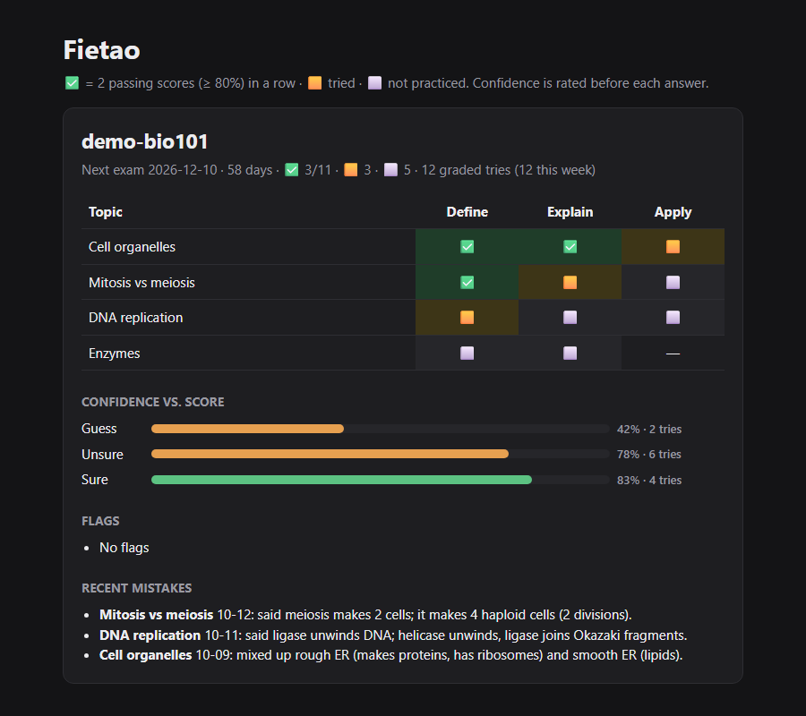

# Fietao

An AI study coach for any AI coding agent (Claude Code, Codex, Gemini CLI, Cursor, ...) that tutors you without doing your homework, and scores you honestly.



## Why I built it

I study computer science, and my studying was disorganised: notes everywhere, no idea what I actually knew,
and AI chats that just handed me answers. This keeps every class in one place and makes the AI coach me instead.

How it fixes that:
- **One folder per class.** Materials, notes, word cards, checklist and scores all live together.
- **You always know what to study next.** `status.py` lists the weak, stale and untested topics.
- **Teaches with hints, not answers.** It refuses to help on graded work that's still open.
- **Asks how sure you are (1–3) before every question**, then checks whether you were right. Being "sure" and wrong is the most useful thing to find out.
- **Tests every topic in 3 formats** (e.g. Define / Explain / Apply), so one format can't hide gaps.
- **Only marks a topic done after 2 passing scores in a row.** A script checks this, so the AI can't just say "you've got it."

## How it works

```
AGENTS.md       ← the rules every AI follows (CLAUDE.md and GEMINI.md import it)
your-class/
  materials/    ← drop your slides, PDFs, readings here
  notes/        ← the AI writes notes + word cards from them
  progress.md   ← topic × format checklist + mistake log
  scores.md     ← one line per graded answer (score + confidence)
tools/
  status.py     ← flags fake ✅, stale topics, untested formats near the exam
  report.py     ← builds the page above
  stop_check.py ← hook: if the AI asked a question but didn't log the score, it's sent back
.claude/skills/
  flashcards/   ← "flashcards for chem101": drills your word cards, logs the score
  visual-learn/ ← "visualize mitosis": builds an interactive lesson page
```

## Quick start

Needs Python 3.10+ and an AI coding agent.

```
git clone https://github.com/fietao/Fietao-study.git
cd Fietao-study
python tools/report.py        # builds report.html from the demo class
```

Add your own class:
1. Copy `_template/` to a new folder, e.g. `chem101/`.
2. Put your course files in `chem101/materials/`.
3. Open your AI agent in this folder and say **"set up chem101"**. It writes notes, word cards and the checklist.
4. Say **"study chem101"** to start practicing.

Run `python tools/status.py` any time to see what needs work.

## How I use it

1. After each lecture, drop the slides into `materials/` and say "set up <class>".
2. Start a session with `python tools/status.py <class>` and work the flags first.
3. Study with the AI: hint → my answer → it grades and logs the score.
4. Open the report to see which topics and formats are still weak.
5. Before an exam, say "flashcards for <class>" to drill terms. Weak ones come up first.
6. When something won't click, say "visualize <topic>" for a step-by-step page to play with.

## Works with any AI

| Tool | What it loads |
|---|---|
| Claude Code | Everything automatically: `CLAUDE.md` → `AGENTS.md`, the skills, the stop hook |
| Gemini CLI | `GEMINI.md` → `AGENTS.md` |
| Codex, Cursor, others | `AGENTS.md`, which tells the agent where the skill files are and to log scores itself |

Another tool that doesn't read `AGENTS.md`? Tell it: "Read AGENTS.md and follow it."

## Your materials, your rules

This repo ships no course content. You bring your own files, and they stay on your machine.
Fill in your class's AI policy in its `CLAUDE.md`. Following your school's rules is up to you.

## Tests

```
python -m unittest discover -s tools/tests -t .
```

## License

MIT
